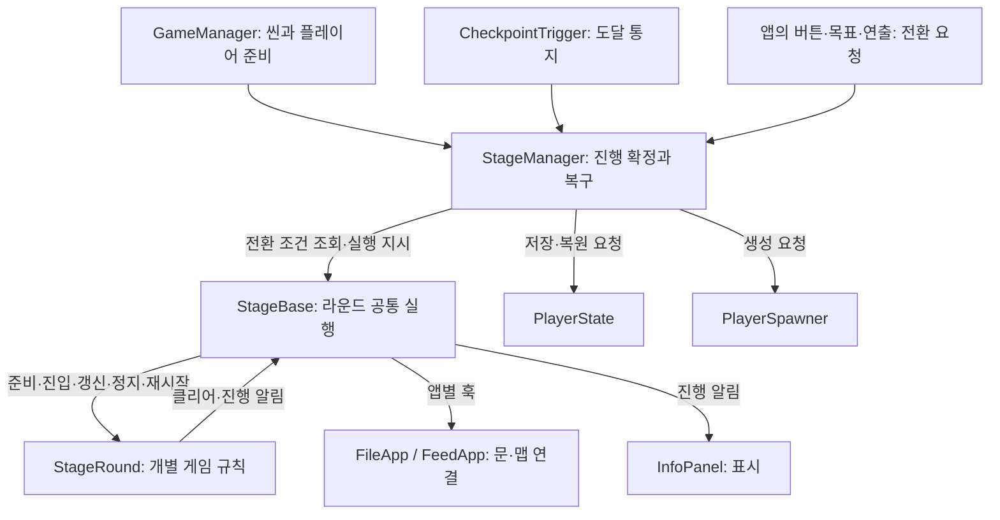

# StageManager · StageBase · StageRound 책임 분리 설계

작성일: 2026-10-21  
상태: 설계 제안. 이 문서 작성으로 런타임 코드·씬·프리팹은 변경하지 않는다.

## 1. 설계 결론

**StageManager는 진행과 플레이어 복구를 확정하고, StageBase는 한 스테이지의 라운드를 실행하며, StageRound는 라운드 하나의 게임 규칙을 구현한다.**

`FileApp`과 `FeedApp`은 StageBase의 구현체다. 각 앱은 라운드 구성, 전환 조건, 맵 연결을 제공하고, 공통 실행 절차는 StageBase가 담당한다. StageBase는 별도로 생성하는 관리자 컴포넌트가 아니다.

핵심 경계는 다음과 같다.

- **무엇을 해야 다음으로 갈 수 있는가:** StageRound와 각 앱의 규칙.
- **진행을 실제로 바꿔도 되는가:** StageManager의 실행 상태·인덱스·복구 기준 검증.
- **확정된 라운드를 시작하고 멈추는 방법:** StageBase의 공통 실행 절차.

라운드 번호를 바꾸는 일과 라운드 게임 오브젝트를 활성화하는 일을 구분한다. StageManager가 번호를 확정하고, StageBase가 그 번호에 해당하는 로직을 실행한다.

## 2. 현재 코드에서 확인한 문제

| 현재 위치 | 확인한 사실 | 문제 |
|---|---|---|
| StageManager | 체크포인트 도달 시 `_currentRoundIndex` 변경, 능력치 스냅샷 저장·복구, 낙하·사망 처리 | 진행의 기준은 있으나 앱이 요청하는 라운드 전환 경로가 없다. |
| StageBase | StageType, StageProgress, 추상 StartStage·EndStage만 존재 | 라운드 실행의 공통 구현이 없어 각 앱이 따로 관리한다. |
| FileApp | Update에서 Manager의 번호를 읽어 StageRound 활성화·Tick, 부활 이벤트 전달, 파괴 시 구독 해제 | 공통 실행 코드와 미로 전용 문 연결 코드가 함께 있다. |
| FeedApp | FeedRound2.IsStarted로 현재 라운드를 별도 판단, 수집과 분류 집계를 직접 처리 | Manager의 현재 라운드와 앱이 표시하는 현재 라운드가 달라질 수 있다. |
| StageRound | 준비·정리·진입·이탈·Tick·부활·클리어 계약 제공 | FileApp만 사용하고, Begin이 준비인지 실제 시작인지 이름상 모호하다. |
| FeedRound2 | Begin에서 맵 생성·이전 맵 삭제 후 OnStarted 발생 | OnStarted를 받은 다음 Manager에 알리는 방식은 이미 맵을 바꾼 뒤 전환을 검증하게 된다. |
| 사망 복구 | OnPlayerRespawnRequested를 스포너와 라운드가 함께 구독 | 플레이어 생성 완료보다 타이머 재시작이 먼저 일어날 수 있다. |

이전 대화에서 말한 “StageBase도 현재 라운드를 관리한다”는 표현은 아래처럼 제한한다. **StageBase는 Manager가 확정한 상태를 실행할 뿐, 별도의 현재 라운드 값을 갱신하지 않는다.**

## 3. 책임과 상태의 소유자

| 항목 | 소유자 | 다른 클래스의 접근 |
|---|---|---|
| 현재 스테이지 실행 상태, 성공·실패, 전환·복구 중 여부 | StageManager | 읽기만 허용 |
| CurrentRoundIndex | StageManager | Base와 UI는 읽기만 허용 |
| 전체 라운드 수 RoundCount | StageBase 구현체의 구성 | Manager가 검증·조회 |
| 체크포인트 목록, 현재 체크포인트, 라운드별 복귀 지점 | StageManager | 앱이 직접 변경하지 않음 |
| HP·배터리 라운드 스냅샷 데이터 | 기존 PlayerState | 저장·복원 시점은 Manager가 결정 |
| 라운드 로직 목록, 실행 중인 로직 참조 ActiveRound | StageBase | 앱이 구성하고 UI가 조회 |
| 라운드별 IsCleared, 수집 목록, 목표값, 남은 시간 | 각 StageRound | Base가 이벤트를 전달하고 UI가 조회 |
| 문·패널·피드 맵 등 앱별 연결 참조 | FileApp / FeedApp 또는 해당 라운드 | Manager는 구체 타입을 모름 |

ActiveRound는 현재 실행 대상의 참조다. 별도의 진행 번호가 아니다. 라운드 전환·복구 도중에는 일시적으로 비활성화할 수 있다.

`StageProgress`는 현재 FeedApp에서 수집 개수로 사용한다. 라운드 번호나 전체 완료율로 재해석하지 않는다. Manager의 `CurrentClearProgress`와 같은 값을 따로 유지하지 말고, 필요한 표시 값은 라운드의 원본 상태에서 조회한다.

## 4. StageManager의 정확한 역할

### 담당하는 일

1. 현재 씬의 StageBase 구현체를 연결하고 StageType을 검증한다.
2. 준비·플레이어 스폰·최초 스냅샷이 완료됐는지 확인해 스테이지 실행을 허용한다.
3. 체크포인트와 앱에서 들어오는 전환 요청을 하나의 진입점으로 처리한다.
4. 현재 앱의 전환 조건, 다음 인덱스, 복귀 지점, 스냅샷 저장 성공 여부를 확인한 뒤 현재 라운드를 확정한다.
5. StageBase에 확정된 전환을 적용하도록 지시한다.
6. 낙하 후 생존 복귀, 사망 후 재스폰, 최초 능력치 복원 순서를 조정한다.
7. 앱의 완료 요청을 검증하고 스테이지 완료·실패 이벤트를 한 번만 발생시킨다.

### 경계

Manager에는 숫자 식 계산, 피드 재료 종류, 도둑 포획 수, 문 열기, 라운드별 Tick을 넣지 않는다. `if (StageType == FileApp)`으로 앱 규칙을 분기하지 않고 StageBase의 계약을 호출한다.

플레이어 생성 자체는 PlayerSpawner, 스냅샷 보관은 PlayerState, 씬 전환은 기존 GameManager·SceneLoader의 책임을 유지한다. Manager는 이들의 실행 시점을 조정한다. 전체 캠페인 완료 판단도 이번 설계에 추가하지 않는다.

## 5. StageBase의 정확한 역할

StageBase는 **한 스테이지를 실행하는 공통 코드**다. Manager와 같은 상위 진행 관리자가 아니다.

### 담당하는 일

1. 자식 앱이 제공하는 RoundCount와 라운드 로직 목록을 검증한다.
2. 라운드들의 준비·정리와 공통 이벤트 연결·해제를 수행한다.
3. Manager가 확정한 라운드에 대해 이전 로직 이탈 → 다음 로직 진입을 한 번씩 실행한다.
4. 실행 가능 상태일 때 ActiveRound에만 Tick을 호출한다.
5. 복구 시작 시 현재 로직을 정지하고, 복구 완료 후 현재 라운드의 재시작 처리를 호출한다.
6. 진행 변경 이벤트를 UI에 전달하고, 앱별 후속 처리를 위한 훅을 제공한다.
7. 자식 앱의 다음 라운드·완료 요청을 Manager에 전달한다.

### 경계

Base는 현재 라운드 번호를 증가시키거나 스냅샷을 저장하지 않는다. 체크포인트를 찾거나 플레이어를 생성하지 않는다. 숫자 퍼즐·피드 분류의 조건도 직접 판단하지 않는다.

라운드 변경은 Manager가 Base를 직접 호출해 적용한다. UI용 `OnRoundChanged` 이벤트를 Base가 다시 구독해서 동일한 전환을 중복 실행하지 않는다. 구독 순서가 실행 순서를 결정하지 않게 한다.

### 전체 라운드 수와 로직 개수

`RoundCount`는 앱의 전체 플레이 구간 수다. FileApp은 3, FeedApp은 2를 제공한다. Manager의 체크포인트 배열 길이를 전체 라운드 수의 별도 원본으로 사용하지 않는다.

현재 FileApp 1라운드는 별도의 로직 클래스가 없으므로 StageRound 객체는 두 개뿐이다. 따라서 `RoundCount = 로직 목록.Count`로 계산하지 않는다.

- 모든 등록 로직의 RoundIndex는 `0 <= index < RoundCount`여야 한다.
- 같은 인덱스에 로직을 두 개 등록할 수 없다.
- 로직 없는 구간은 앱이 명시적으로 허용한다. FileApp 1라운드는 지정 출구·체크포인트 도달을 전환 조건으로 사용한다.
- 필수 로직을 찾지 못한 상태를 “로직 없는 구간”으로 취급하지 않는다. 퍼즐 노드·패널 누락은 준비 실패다.
- Manager는 각 라운드의 유효한 복귀 지점 매핑이 있는지 시작 전에 검증한다. 앱이 정의한 RoundCount와 매핑이 어긋나면 설정 오류다.

## 6. StageRound와 각 앱의 역할

### StageRound

StageRound는 현재처럼 `[Serializable]` 일반 클래스로 유지하고, 앱이 필드로 소유한다. 별도 씬 관리자 컴포넌트나 Update를 만들지 않는다.

| 실행 단계 | 의미 | 호출 주체 |
|---|---|---|
| Prepare | 참조 탐색·검증, 이벤트 연결, 초기 상태 준비. 게임 진행은 시작하지 않음 | StageBase |
| Enter | 현재 라운드에 실제 진입. 상호작용·타이머 활성화 | StageBase |
| Tick | 활성 상태에서 필요한 갱신 | StageBase |
| Exit | 타이머·입력·게임 판정 정지. 준비 구독을 모두 해제하는 단계와 구분 | StageBase |
| Restart | 재스폰과 능력치 복원 이후 라운드별 재시도 처리 | StageBase |
| Dispose | 구독·참조 정리. 반복 호출에 안전하게 구현 | StageBase |

이 이름들은 **제안 계약**이다. 현재 Begin은 Prepare, OnRoundEntered·OnRoundExited는 Enter·Exit, End는 Dispose에 대응한다. 현재 부활 요청 훅은 재스폰 완료 이후의 Restart로 의미를 분명하게 바꾼다.

StageRound는 게임 조건을 만족하면 IsCleared를 갱신하고 한 번만 알린다. 직접 다음 라운드로 이동하거나 StageManager를 검색하지 않는다. 타이머 종료 등 플레이어 사망이 게임 규칙이면 기존 전투·능력치 경로로 사망을 발생시키고, 재스폰은 Manager가 처리한다.

비활성·복구 중에는 Tick뿐 아니라 수집·사격·코루틴 콜백 등 게임 판정도 차단한다. 이미 시작된 비동기 작업을 멈추거나 결과를 무시하는 구체 처리는 각 라운드와 앱 어댑터가 담당한다.

### FileApp

- 기존 NumberPuzzleRound와 ThiefChaseRound를 구성한다.
- 로직 없는 1라운드를 명시하고 출구 도달 조건을 제공한다.
- `Maze_0`, `Maze_1`, `Maze_2`와 라운드를 연결한다.
- 퍼즐·도둑 라운드 클리어 시 해당 출구를 연다.
- 공통 Update·부활 전달·라운드 구독 정리는 Base에 맡긴다.

### FeedApp

- 제안 클래스 FeedCollectRound(1라운드), FeedSortRound(2라운드)를 구성한다.
- FeedCollectRound는 보유 재료와 필수 재료 충족 여부를 관리한다.
- FeedSortRound는 분류 전체 수·남은 수·클리어 상태를 관리한다.
- 기존 Map.Feed.FeedRound2는 벽·발판 생성과 피드 이동을 수행하는 맵 컴포넌트로 우선 유지한다. FeedSortRound는 그 컴포넌트의 실행·상태를 연결한다.
- 기존 HasItem·CollectItem·진행도 API는 필요한 동안 라운드에 위임하는 호환 창구로 유지한다. 같은 수집 목록·분류 카운터를 앱과 라운드 양쪽에 중복 저장하지 않는다.
- `FeedRound2.IsStarted`는 맵 동작 상태로 사용한다. 현재 라운드 번호의 또 다른 기준으로 사용하지 않는다.

## 7. 제안 API와 호출 권한

아래 API는 구현된 코드가 아니라 책임을 검토하기 위한 계약이다. public·internal·protected의 최종 접근 수준은 구현 시 현재 어셈블리 경계에 맞춘다.

| 소유자 | 제안 계약 | 호출자·의미 |
|---|---|---|
| Manager | CurrentRoundIndex, IsRunning | 읽기 전용 진행 상태 |
| Manager | TryAdvanceRound(sourceStage, expectedRoundIndex) | 지정 체크포인트 또는 현재 앱의 명시적 요청. 현재 번호와 요청 시점 번호가 같아야 함 |
| Manager | TryCompleteStage(sourceStage) | 현재 앱의 최종 완료 요청 검증 |
| Manager | GetSpawnPoint() | PlayerSpawner가 복귀 위치 조회. 기존 계약 유지 |
| Base | RoundCount, ActiveRound | 앱 구성과 실행 로직 조회 |
| Base | PrepareStage(manager) | Manager가 실행 전 준비·검증 요청 |
| Base | StartStage() | Manager가 준비 완료 후 최초 실행 |
| Base | CanAdvanceRound(nextIndex) | 앱의 읽기 전용 전환 조건·다음 로직 준비 여부 검증 |
| Base | ApplyRoundChange(previousIndex, nextIndex) | Manager만 호출. 검증·스냅샷 저장·번호 확정 후 로직 전환 |
| Base | SuspendCurrentRound(), RestartCurrentRound() | Manager가 복구 시작·완료 시 각각 호출 |
| Base | CanCompleteStage | 앱이 최종 목표와 연출 완료 여부를 판단 |
| Base | EndStage() | 완료·실패·씬 종료 시 실행 정리 |
| Base | RequestNextRound(), RequestStageCompletion() | 자식 앱이 Manager에 보내는 요청 창구 |
| Base | OnProgressChanged | UI용 알림. 진행을 확정하는 명령으로 사용하지 않음 |

Manager의 전환 검사는 다음 순서다.

1. 요청자가 연결된 현재 앱인지, 스테이지가 실행 중인지 확인한다.
2. 플레이어가 생존해 있고 전환·사망 복구 중이 아닌지 확인한다.
3. expectedRoundIndex가 현재 값인지 확인한다. 중복·지연 요청을 거절한다.
4. 다음 번호를 현재 번호 + 1로 계산한다. 임의 건너뛰기·역행을 허용하지 않는다.
5. Base.CanAdvanceRound와 다음 복귀 지점의 유효성을 확인한다.
6. PlayerState에 다음 라운드 최초 스냅샷을 저장하고 성공 여부를 확인한다.
7. 전환 중 재진입을 막은 상태에서 현재 번호를 확정하고 ApplyRoundChange를 호출한다.
8. 실행 적용이 끝난 뒤 외부 라운드 변경·진행 이벤트를 알린다.

실패 가능한 참조·설정·조건 검증은 맵을 변경하기 전에 끝낸다. 적용 중 예외가 발생하면 실행을 정지하고 오류를 보고한다. 이미 파괴한 맵을 정수 인덱스만 되돌려 복구됐다고 처리하지 않는다.

## 8. 실제 실행 흐름

### 최초 시작

1. Manager가 현재 앱을 연결하고 Base.PrepareStage로 구성·참조·복귀 매핑을 준비한다. 아직 라운드를 활성화하지 않는다.
2. 기존 GameManager·PlayerSpawner 흐름으로 플레이어를 생성하고 초기 Effect·씬 전환 능력치를 적용한다.
3. Manager가 PlayerState에 0번 라운드 최초 스냅샷을 저장하고 현재 번호를 0으로 확정한다.
4. 준비와 저장이 모두 성공하면 실행 상태를 켜고 Base.StartStage를 호출한다.
5. Base가 0번 로직을 활성화한다. 준비만 된 다른 라운드의 타이머·상호작용은 실행하지 않는다.

### 파일 앱: 퍼즐 정답 이후

1. NumberPuzzleRound가 정답을 확인하고 클리어를 알린다.
2. Base가 FileApp 훅으로 알리고 FileApp이 2라운드 출구를 연다. 현재 라운드는 그대로다.
3. 플레이어가 다음 라운드의 지정 체크포인트에 도착한다.
4. Manager가 공통 전환 검사와 다음 스냅샷 저장을 수행한다.
5. 현재 번호를 2로 확정하고 Base가 퍼즐 라운드에서 도둑 라운드로 전환한다.

퍼즐 정답만으로 번호를 증가시키지 않는다. 또한 지정 체크포인트에 도달했다는 사실만으로 필수 퍼즐 클리어 검사를 생략하지 않는다.

### 피드 앱: 재료 수집 이후

1. FeedCollectRound가 필수 재료 충족 상태를 알린다. 재료 수집 완료만으로 다음 라운드에 들어가지 않는다.
2. 기존 시작 버튼은 FeedRound2.Begin을 직접 호출하는 대신 FeedApp의 시작 요청 창구를 호출하도록 연결한다.
3. FeedApp이 Base를 통해 Manager.TryAdvanceRound를 요청한다.
4. Manager가 재료 충족·맵 설정 준비·2라운드 복귀 지점·스냅샷 저장을 확인하고 1번 라운드로 확정한다.
5. Base가 FeedSortRound를 활성화한다. 이때 FeedRound2.Begin을 호출해 기존 벽·발판·피드 연출을 실행한다.
6. 분류 진행은 FeedSortRound가 추적하고 Base의 진행 이벤트로 UI에 전달한다.

현재 FeedRound2.Begin은 벽 설정 오류로 중간 거절할 수 있다. 이 검증을 진입 전 준비 검사에서 수행할 수 있도록 어댑터 또는 맵 컴포넌트 계약을 정리해야 한다. Manager에 Map.Feed 타입 검사를 넣어 해결하지 않는다.

FeedRound2.Begin의 OnStarted는 “맵 동작 시작 완료 통지”다. 다음 라운드로 넘어가라는 명령으로 다시 사용하지 않는다. 피드가 0개여서 Begin 안에서 즉시 클리어되는 경우도 놓치지 않도록 진입 전에 이벤트 연결을 완료한다.

**중요:** 피드 2라운드는 1라운드 맵을 삭제한다. 2라운드 복귀 지점은 삭제 대상 밖에 두거나 실행 전 안정적인 위치를 준비해야 한다. 준비 단계에서 이전 맵을 삭제하지 않는다.

### 사망 후 재시도

1. Manager가 복구 중 상태로 바꾸고 Base.SuspendCurrentRound를 호출한다. 타이머·상호작용을 정지한다.
2. Manager가 일반 체크포인트를 현재 라운드 시작점으로 되돌리고 기존 스포너에 재생성을 요청한다.
3. 새 플레이어 생성과 등록이 끝나면 Manager가 PlayerState의 해당 라운드 최초 HP·배터리를 복원한다.
4. 복원이 성공한 뒤 Base.RestartCurrentRound를 호출한다. 구체적인 리셋 범위는 각 라운드가 정한다.
5. 준비가 끝나면 복구 상태를 해제하고 실행을 재개한다. 타이머는 이 시점부터 진행한다.

OnPlayerRespawnRequested는 생성 요청 통지로 제한한다. 라운드의 재시작 완료 신호로 겸용하지 않는다. PlayerSpawner·라운드의 이벤트 구독 순서에 의존하지 않는다.

재시도는 현재 번호와 최초 스냅샷을 유지한다. 새 스테이지 시도를 시작할 때만 스냅샷을 비운다. 생존 낙하는 현재 라운드의 리셋 없이 기존 체크포인트로 복귀한다. 첫 라운드 사망 시 씬 재로드 옵션도 Manager에 유지한다.

숫자 퍼즐의 목표값 재선정, 도둑 재생성, 피드 수집·분류 진행 보존 등 기존 규칙은 각 라운드와 기존 맵·AI 컴포넌트에 맞춰 유지한다. 이번 설계만으로 모든 라운드를 일괄 초기화하는 정책을 추가하지 않는다.

### 최종 완료와 정리

마지막 StageRound.IsCleared는 그 라운드의 게임 조건 충족을 뜻한다. 스테이지 종료 조건과 자동으로 같게 취급하지 않는다.

- FileApp은 마지막 출구·목적지 도달까지 앱의 완료 조건으로 판단한다.
- FeedApp에는 분류 완료 뒤 FeedComposeSequence가 있다. 분류 완료는 후속 화면을 여는 조건이고, 최종 완료 연결은 기존 작성 연출·목적지 조건을 명시적으로 따라야 한다. 이번 설계에서 분류 완료 즉시 씬을 종료하지 않는다.
- Manager가 Base.CanCompleteStage를 검증한 후 실행을 멈추고 Base.EndStage를 호출한 뒤 완료 이벤트를 알린다.
- Base는 활성 라운드 Exit, 전체 라운드 Dispose, 앱별 맵 구독 정리를 수행한다. 파괴 시에도 같은 정리 경로를 사용하고 중복 정리에 안전하게 한다.

## 9. 현재 파일에서 옮길 코드

| 현재 코드 | 설계 후 위치 |
|---|---|
| FileApp의 `_rounds` 실행 목록, ActiveRound 조회, 공통 진행 이벤트 | StageBase |
| FileApp.Update의 라운드 번호 매 프레임 비교 | 제거. Manager가 전환 시 Base에 직접 통지 |
| 활성 라운드 Tick | StageBase의 공통 실행 경로 |
| FileApp의 공통 Begin·End 호출, 부활 전달, 구독 정리 | StageBase의 준비·복구·종료 경로 |
| FileApp.ConnectMazeGates와 미로 이름·출구 참조 | FileApp에 유지 |
| FeedApp의 수집 목록·필수 재료 판정 | FeedCollectRound |
| FeedApp의 분류 전체 수·남은 수 변경 검사 | FeedSortRound |
| FeedApp의 IsStarted 기반 CurrentRound | 제거 또는 Manager 값 조회로 교체 |
| StageManager의 체크포인트·사망·스냅샷·복귀 위치 | Manager에 유지 |
| 체크포인트에서 번호를 직접 바꾸는 부분 | Manager의 공통 전환 함수로 통합 |
| StageRound의 준비와 활성화가 혼동되는 이름 | Prepare·Enter·Exit·Restart·Dispose 의미로 명확화 |
| UI가 앱별로 따로 구독하는 진행 알림 | 공통 StageBase 알림으로 연결. 숫자·문구 변환은 UI 역할 유지 |

## 10. 적용 순서와 검증 기준

이 문서의 산출물은 설계다. 아래는 후속 구현 순서이며 이번 작업에서 실행하지 않는다.

1. Base에 라운드 구성·실행 계약을 만들고 FileApp 공통 실행 코드를 옮긴다. Tutorial·SecurityApp·LiveApp의 기존 상속도 함께 호환시킨다.
2. Manager에 단일 전환 함수와 명시적인 Base 호출을 연결한다. 기존 체크포인트·스냅샷 동작을 보존한다.
3. 스폰 완료 이후 재시작 순서를 연결하고 구독 순서 의존성을 제거한다.
4. FeedCollectRound·FeedSortRound를 만들고 기존 FeedApp 외부 API를 위임한다.
5. 별도 변경 범위를 확인한 뒤 피드 버튼의 직결과 맵 진입 전 검증·안전한 복귀 위치를 연결한다.
6. UI를 공통 알림에 연결하고 두 앱의 실제 흐름을 검증한다.

기존 intent-053·055는 Core 중심 수정과 Map·AI·맵 씬 변경 제한이 있다. 이 문서는 해당 제한을 해제하지 않는다. 피드 버튼·맵 계약 변경은 후속 구현 범위로 구분한다. CP949인 FeedApp 등 기존 파일의 인코딩도 보존한다.

| 검증 상황 | 통과 기준 |
|---|---|
| 최초 입장 | 최초 스냅샷 성공 후 0번 라운드만 활성화 |
| 같은 체크포인트·버튼 중복 요청 | 번호 증가·진입·스냅샷 저장이 한 번만 실행 |
| 퍼즐 클리어 전 다음 체크포인트 접근 | 앱 조건에 따라 전환 거절 |
| 퍼즐 정답 | 문만 열리고 지정 체크포인트까지 현재 라운드 유지 |
| 피드 재료 부족·맵 참조 누락·복귀 지점 누락 | 번호·스냅샷·기존 맵을 바꾸기 전에 거절 |
| 피드 2라운드 진입 | Manager·Base·UI의 라운드가 일치하고 분류 맵 한 번 시작 |
| 피드가 처음부터 0개 | 즉시 클리어 알림을 놓치지 않고 최종 완료와 구분 |
| 타이머 중 사망 | 복구 중 시간 감소 없음, 새 플레이어 능력치 복원 후 재시작 |
| 사망·재접촉·재시도 | 라운드 최초 스냅샷을 덮어쓰지 않음 |
| 피드 이전 맵 삭제 후 사망 | 유효한 2라운드 복귀 지점 사용 |
| 낙하 후 생존 | 일반 체크포인트 복귀, 게임 규칙 초기화 없음 |
| 준비만 된 비활성 라운드 | 수집·피격·타이머·지연 콜백으로 진행되지 않음 |
| 마지막 게임 조건 충족 | 앱의 최종 완료 조건까지 실행 유지 |
| 완료·실패·씬 종료 | Tick 중지, 이벤트 해제, 이전 라운드 콜백 무효화 |

## 11. 검토 근거

현재 파일을 읽고 설계했으며 아래 링크는 현재 구현이다. 위의 새 계약이 이미 구현돼 있다는 뜻은 아니다.

- [StageManager](../../Assets/_Project/Scripts/Core/Stage/StageManager.cs)
- [StageBase](../../Assets/_Project/Scripts/Core/Stage/StageBase.cs)
- [StageRound](../../Assets/_Project/Scripts/Core/Stage/StageRound.cs)
- [FileApp](../../Assets/_Project/Scripts/Core/Stage/FileApp.cs)
- [FeedApp](../../Assets/_Project/Scripts/Core/Stage/FeedApp.cs)
- [GameManager](../../Assets/_Project/Scripts/Core/GameManager.cs), [PlayerState](../../Assets/_Project/Scripts/Core/PlayerState.cs)
- [FeedRound2](../../Assets/_Project/Scripts/Map/Feed/FeedRound2.cs), [피드 버튼 프리팹](../../Assets/_Project/Prefabs/Map/Feed/Round2/FeedRound2.prefab)
- [FeedComposeSequence](../../Assets/_Project/Scripts/Map/Feed/FeedComposeSequence.cs)
- [관련 작업 의도](../intent/intent-055-file-app-round-split.md)
